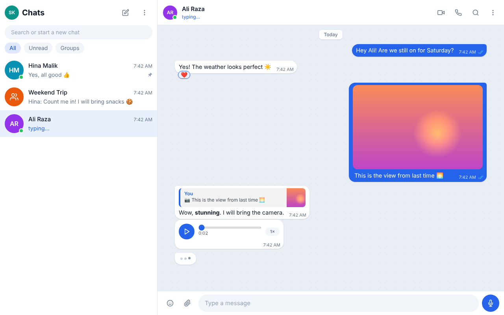
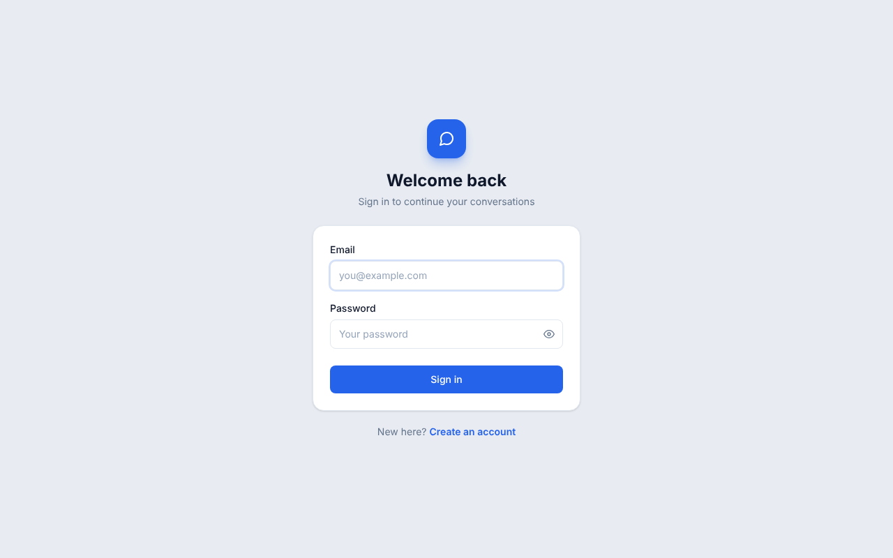
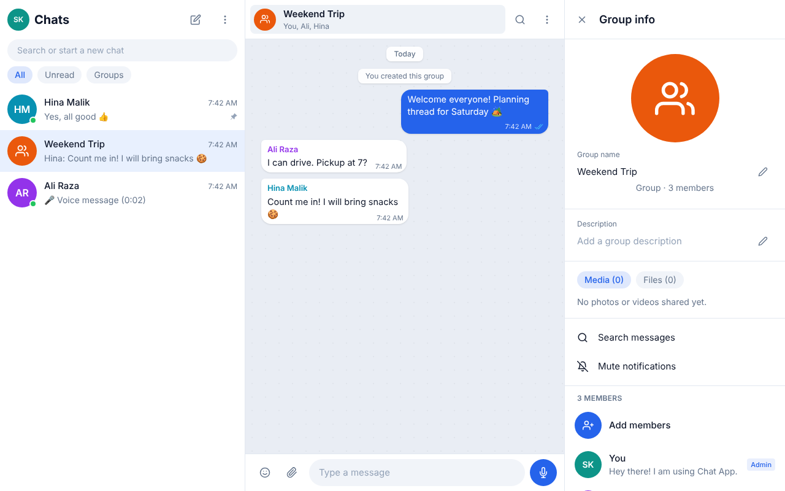
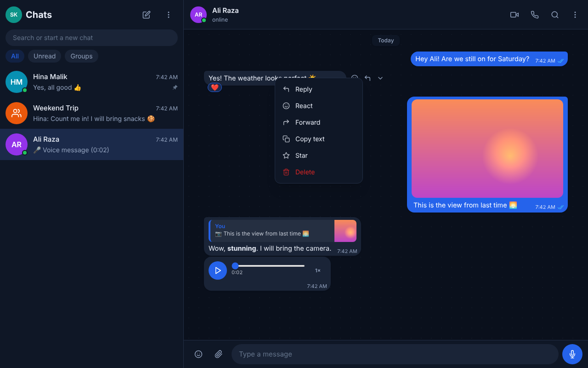
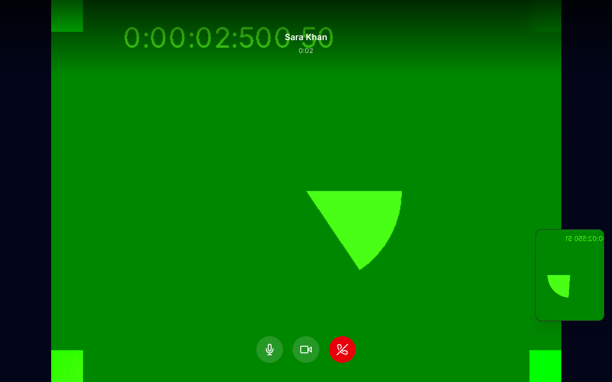
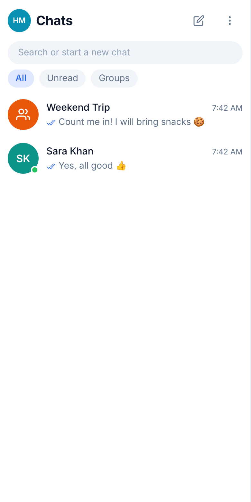
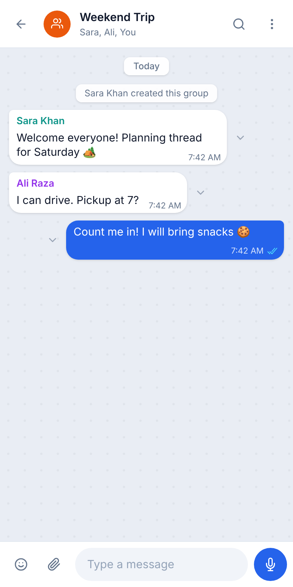

# Chat App

A real-time messaging web app built with the MERN stack and Socket.io: one-to-one and group chats, read receipts, media and voice messages, reactions, and voice/video calls.



## Features

**Messaging**

- Real-time delivery with Socket.io, with optimistic sending, retry on failure and automatic resync after a reconnect
- Sent / delivered / read ticks, in direct chats and groups, plus a per-message "Message info" view
- Reply, forward, edit, copy, star, react with any emoji, delete for me / for everyone
- Photos, videos, documents (up to 25 MB) with upload progress, captions, drag & drop and paste
- Voice messages recorded in the browser, with seek and playback speed
- Typing indicators, online status and "last seen"
- Clickable links and `*bold*`, `_italic_`, `~strikethrough~`, `` `code` `` formatting
- Search inside a chat and jump to the result; infinite scroll through history
- Day separators, unread divider, scroll-to-latest button

**Chats**

- Pin, archive, mute, mark as unread, clear and delete chats
- Unread counts, All / Unread / Groups filters, search for chats and people
- Starred messages list, shared media and files per chat
- Block / unblock contacts

**Groups**

- Create groups with a name, icon and description
- Multiple admins: add / remove members, promote / dismiss admins, edit group info
- Group events in the timeline ("Sara added Ali"); new members don't see older history

**Calls**

- One-to-one voice and video calls (WebRTC) with mute / camera toggles
- Missed, declined and completed calls are logged in the chat

**App**

- Responsive layout: two-pane on desktop, single-pane with back navigation on phones
- Light, dark and system themes
- Sound and desktop notifications, unread count in the tab title
- Profile photo, name and about; change password
- JWT auth, rate-limited login, authenticated sockets, validated input

## Screenshots

| Sign in | Group info |
| --- | --- |
|  |  |

| Dark mode and message menu | Video call |
| --- | --- |
|  |  |

| Mobile: chat list | Mobile: chat |
| --- | --- |
|  |  |

## Tech Stack

- **Frontend:** React 19, Vite, Tailwind CSS 4, React Router, Socket.io client, Axios
- **Backend:** Node.js, Express 5, MongoDB + Mongoose, Socket.io, JWT + bcrypt
- **Files:** stored in MongoDB GridFS, so uploads survive redeploys without an extra storage service
- **Calls:** WebRTC, with Socket.io for signalling

## Project Structure

```
chat-app/
├── client/                # React + Vite frontend
│   └── src/
│       ├── components/    # chat/, sidebar/, call/, ui/
│       ├── context/       # Auth, Theme, Toast, Chat (realtime state) and Call providers
│       ├── lib/           # API client, socket, formatting, media and notification helpers
│       ├── pages/         # Login, Register, Home
│       └── services/      # One function per API endpoint
├── server/                # Express + Socket.io backend
│   ├── controllers/       # Route handlers
│   ├── models/            # Mongoose schemas (User, Chat, Message)
│   ├── routes/            # Express routers
│   ├── middleware/        # JWT auth, error handling
│   ├── utils/             # Realtime hub, message creation, serializers, migration
│   └── test/              # End-to-end API tests
└── docs/screenshots/
```

## Getting Started

You need Node.js 20.19 or newer.

### 1. Install

```bash
git clone https://github.com/sadiqqgavvi-gif/chat-app.git
cd chat-app
npm run install:all
```

### 2. Run the server

```bash
npm run dev:server
```

With no configuration the server starts a local MongoDB for you and keeps its data in `server/.data` (the first start downloads MongoDB, about 80 MB). To use your own database, copy `server/.env.example` to `server/.env` and set `MONGO_URI` and `JWT_SECRET`.

### 3. Run the client

```bash
npm run dev:client
```

Open `http://localhost:5173`. Vite proxies `/api` and the websocket to the server on port 5000, so the client needs no environment variables in development.

To try a conversation, register two accounts in two different browsers (or one normal and one private window).

### Tests

```bash
npm test
```

Boots the real server against a throwaway MongoDB and exercises auth, messaging, receipts, groups, uploads and call signalling over HTTP and Socket.io.

## Deployment

Set `NODE_ENV=production`, `MONGO_URI` and `JWT_SECRET` on the server in every setup.

**One service (simplest).** The server serves the built client when `client/dist` exists. The root `Dockerfile` does this in one image:

```bash
docker build -t chat-app .
```

```bash
docker run -p 5000:5000 -e MONGO_URI=... -e JWT_SECRET=... chat-app
```

**Client and API on different hosts** (for example Vercel + Back4app). Deploy `server/` with `server/Dockerfile` and set `CLIENT_URL` to the client's origin. Build the client with `VITE_API_URL` and `VITE_SOCKET_URL` pointing at the API (see `client/.env.example`).

**Calls** need HTTPS in production (browsers only allow camera and microphone on secure origins). The default STUN server is enough on most networks; for users behind strict firewalls add a TURN server through `VITE_ICE_SERVERS`.

## Upgrading from the earlier version

Existing data is upgraded automatically on the first start: read receipts move to the new format and each group's admin becomes its first admin. Attachments that were stored inline in old messages keep working.

## License

This project is open source and available for review as part of my portfolio.
